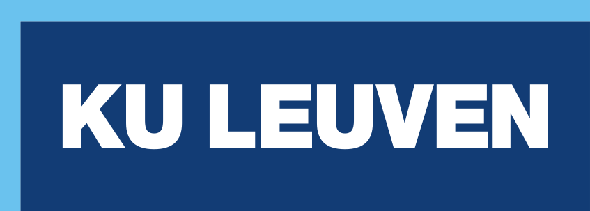
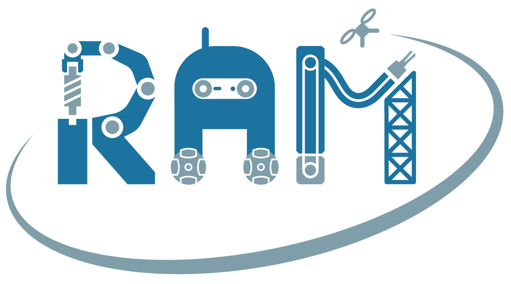

# kuka_iiwa_driver_crospi Package

This package contains a driver for controlling the Kuka iiwa using crospi_core, based on template_driver_crospi package which uses ROS2 plugins.

## Installation

This driver requires the KUKA FRI (Fast Robot Interface) C++ SDK. We cannot distribute this SDK since it has a closed license and needs to be distributed by KUKA.

1. Place the KUKA FRI SDK in *external/kuka_fri_sdk*, such that *external/kuka_fri_sdk/include/friClientApplication.h* and *external/kuka_fri_sdk/build/GNUMake/Makefile* exist:
   ```bash
   cd <your_ws>/src/kuka_iiwa_driver_crospi
   cp -r <path_to_your_kuka_fri_sdk>/. external/kuka_fri_sdk/
   ```
   *external/kuka_fri_sdk* is a git submodule pointing to a private KU Leuven repository; if you have access to it, use `git submodule update --init` instead.
   Alternatively, keep the SDK somewhere else and pass its location to CMake: `colcon build --cmake-args -DKUKA_FRI_SDK_DIR=<path_to_sdk>`.

2. Compile the package using *colcon*:
   ```bash
   cd <your_ws>
   colcon build --packages-up-to kuka_iiwa_driver_crospi
   ```
   The SDK library (*libFRIClient.so*) is built automatically with the SDK's own GNUMake build (no manual `make` needed; the result is kept in *external/kuka_fri_sdk/lib*) and installed together with the driver.

## Documentation

For documentation and tutorials, checkout our [crospi website](https://crospi-website-907f83.pages.gitlab.kuleuven.be/).

## License and acknowledgements

Published under the [Apache-2.0 license](LICENSE), depends on closed source KUKA FRI SDK to be obtained from KUKA by user of this package.


<a href="https://aiprism.eu/"></a>
This work was funded by the European Union’s Horizon 2020 research and innovation program 
under the grant agreement No. <a href="https://cordis.europa.eu/project/id/101058589">101058589</a> ( <a href="https://aiprism.eu/">AI-Prism</a>) 

<p/>

<p/>

<p/>

## Authors
<p float="left">
<a href="https://www.kuleuven.be/english/kuleuven/">
    
</a>
<a href="https://www.mech.kuleuven.be/en/research/ram">
    
</a>
</p>

(c) 2025, KU Leuven, Department of Mechanical Engineering, ROB-Group:

- [Santiago Iregui Rincon](https://www.kuleuven.be/wieiswie/en/person/00125886)
- [Federico Ulloa Rios](https://www.kuleuven.be/wieiswie/en/person/00141400)
